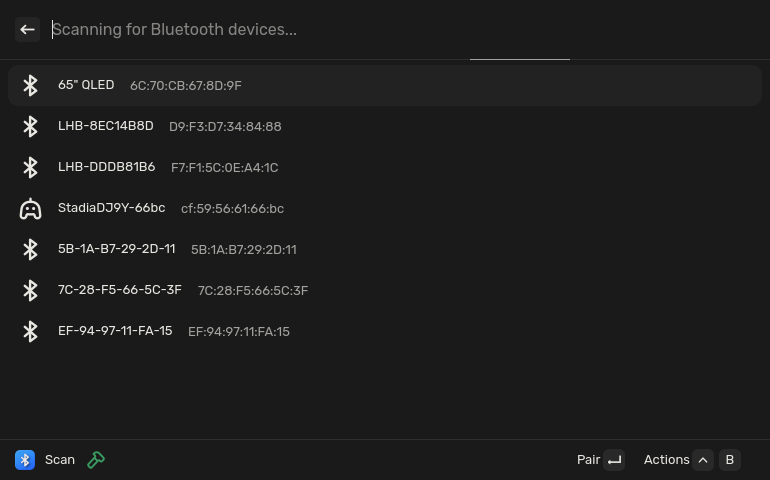
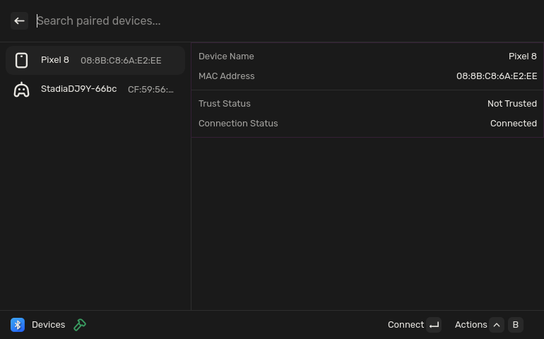

<p align="center">
    
</p>

# Vicinae-Bluetooth

This is a bluetooth extension for [Vicinae](https://github.com/vicinaehq/vicinae).

Vicinae-Bluetooth talks to the BlueZ daemon over D-Bus (`org.bluez`), so make
sure your Linux distro uses BlueZ.

## Battery level

The details panel has a `Battery Level` row for every paired device: the
percentage when BlueZ knows it, `—` when it does not. It is refreshed with the
rest of the list, every two seconds and after every action.

BlueZ knows it only when something exports `org.bluez.Battery1` for that
device: the built-in GATT Battery Service plugin (service `0x180F`, so LE
devices), or a battery provider that registers with the adapter's
`org.bluez.BatteryProviderManager1`. A device with neither — a Classic-only
headset on a host with no provider — shows `—`; that is the stack, not the
extension. `docs/audits/bluetooth-battery.md` records what this machine has.

<p align="center">Scan command:</p>
<p align="center">
    
</p>

<p align="center">Devices command:</p>
<p align="center">
    
</p>

## Installation

To install the project, you need to clone the repository, install the dependencies and run the build command. The extension will then automatically be put in the extension folder of vicinae

```bash
git clone https://github.com/gelei/vicinae-bluetooth.git
cd vicinae-bluetooth
npm install
npm run build
```

### Install dependencies

```bash
npm install
npm run dev
```
If you want to build the production bundle, simply run:

```bash
npm run build
```
