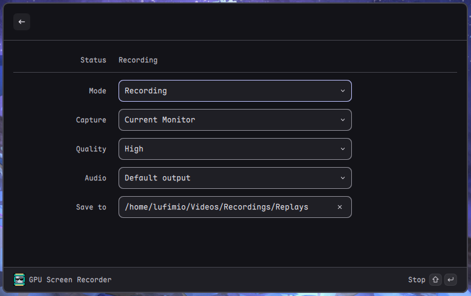
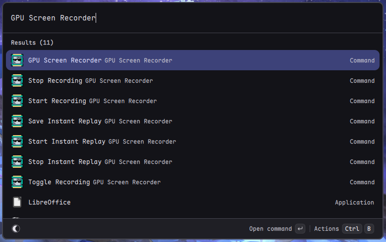

# GPU Screen Recorder

A Vicinae extension for controlling [GPU Screen Recorder](https://git.dec05eba.com/gpu-screen-recorder/).

## Features
- Recording modes: standard screen recording or instant replay (ShadowPlay-like)
- Capture sources: current or specific monitor, or window via the Wayland portal
- Quality presets: Medium, High, Very High, Ultra
- Audio: system and application audio (PipeWire required)

## Commands
- Start Recording — standard screen recording
- Stop Recording — stop active recording and save
- Toggle Recording — start/stop (mode-aware)
- Start Instant Replay — begin the instant replay buffer
- Stop Instant Replay — stop instant replay mode
- Save Instant Replay — save the buffer to file (Ctrl+S when in instant replay)
## Screenshots
> 
> 

## Traps
- The recorder starts detached in its own session; the worker teardown killed it
  while the toast said recording had started — the answer now comes from `pidof`,
  and the output goes to `$TMPDIR/gpu-screen-recorder.log` so a dying start says
  why.
- Window capture is `-w portal`; the portal needs an interactive picker — with no
  app id the Hyprland portal answers `SHAREDATA returned selection -1` and gsr
  fails at once ("desktop portal capture failed"), which is fatal with no window
  on screen: pick a monitor.
- The save location comes back from `ps -p <pid> -o args=`, which joins the args
  with spaces and drops the quoting: reading one word after `-o` cut every path
  with a space (`…/My Recordings/x.mp4` → `…/My`). The path is the whole tail
  after the last `-o` — measured with 6.1.7 writing `/tmp/opencode/space
  dir/re c.mp4`.

## Tests

`npm test` runs `test/recorder.test.ts` under `tsx`: the pure parsers and the
argv readers against gpu-screen-recorder 6.1.7's own output, captured on this
machine. `src/recorder.ts` imports no `@vicinae/api`, which is what lets the
test load it headless.

## Requirements

- [GPU Screen Recorder](https://git.dec05eba.com/gpu-screen-recorder/)
